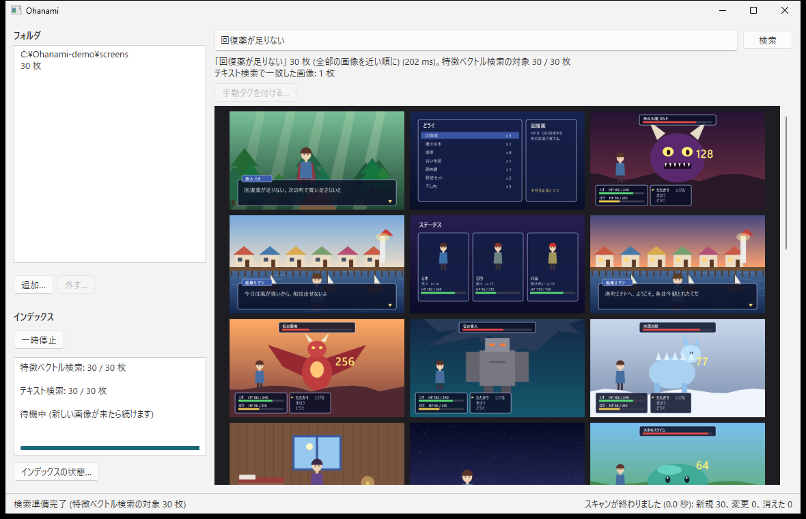
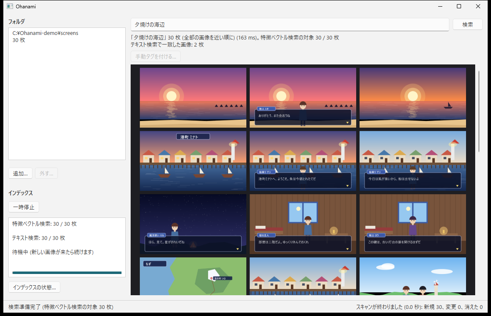
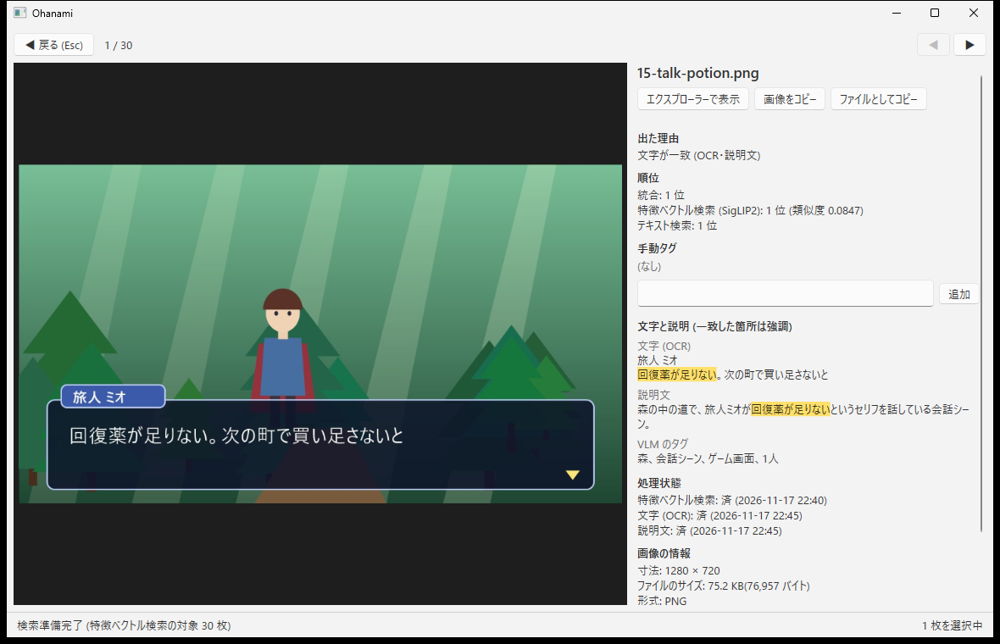
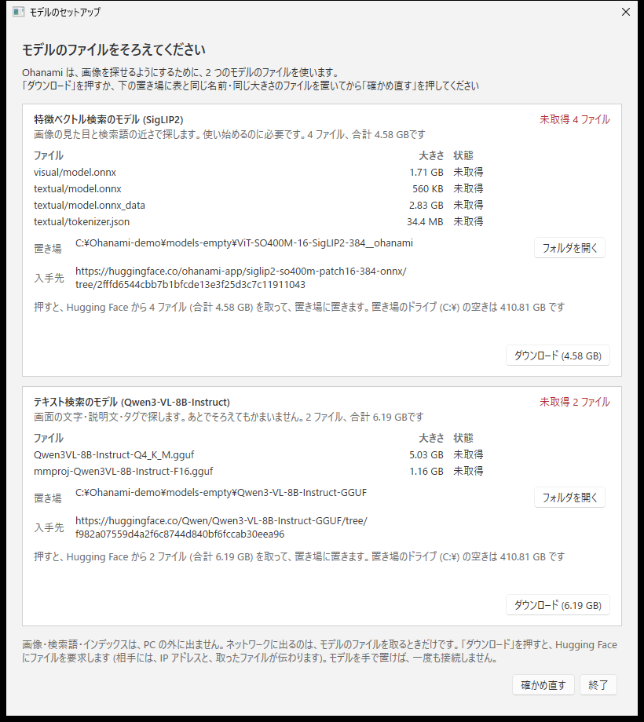

# Ohanami

Ohanami is a local-only screenshot search app for Windows, made for game screenshots. For each image it builds an index (the text on the screen, a short description, and an image feature vector), so you can find a screenshot by what a character said, by what was going on, or by how it looks. Images, search words and the index never leave your PC; the only network access is downloading the model files, and only when you press a button. It needs Windows 11 and an NVIDIA RTX GPU (8 GB VRAM or more). The documentation and the code comments are written in Japanese.

ゲームのスクリーンショットを、セリフ・場面の文脈・見た目で探せる、Windows 向けのアプリです。外部のサービスは使わず、画像・検索語・インデックスは PC の中に置きます。

**テキスト検索**で「回復薬が足りない」を探したところです。画面に写っているセリフが一致した画像が、先頭に出ます。



**特徴ベクトル検索**で「夕焼けの海辺」を探したところです。見た目の近い画像が、上に並びます。



一覧の画像を開くと、詳細画面になります。その画像が一覧に出た理由と順位、画像から読み取った文字 (OCR)、画像の説明文、タグが出て、検索語に一致した箇所は強調されます。



画面の写真の絵・セリフ・名前は、この説明のために作ったものです。

## できること

撮りためたスクリーンショットのフォルダを登録すると、次の 2 つの方法で探せるようになります。検索欄に言葉を入れると、2 つの方法の結果が 1 つの一覧にまとまって出ます。

| 方法 | 探せるもの | 検索語の例(作った例) |
|---|---|---|
| テキスト検索 | 画面に写っている文字(セリフ・メニュー・地名)、画像の説明文、タグ、自分で付けた手動タグ | 「ありがとう」「回復薬が足りない」「港町」 |
| 特徴ベクトル検索 | 画像の見た目や雰囲気 | 「夕焼けの海辺」「雪の中の小さな家」「ボスと戦っている場面」 |

- 一覧のサムネイルは、ドラッグして、ブラウザの投稿欄・エクスプローラー・チャットのアプリなどへ、そのまま渡せます(渡すのはファイルのコピーで、元のファイルは動きません)。「エクスプローラーで表示」「画像をクリップボードにコピー」もあります。
- 結果の詳細画面で、その画像が一覧に出た理由(文字が一致した箇所、特徴ベクトル検索の順位など)を見られます。
- 手動タグを付けて、タグで探せます。
- フォルダは、いくつでも登録できます。新しいスクリーンショットは、撮ってから数秒で拾います。
- 対応する画像の形式は、PNG・JPEG・WebP です。
- ゲームの間に GPU を取り合わないよう、インデックスの作成を一時停止できます。
- スクリーンショットを撮る機能は、ありません(撮るのは、いつも使っているアプリです。Ohanami は、保存されたフォルダを見ます)。Windows 以外の OS には、対応しません。

使う AI モデルは 2 つです。どちらも PC の GPU で動かします。

- **SigLIP2**: 画像と検索語を、特徴ベクトル(数字の並び)にして、近さで探します(特徴ベクトル検索)。
- **Qwen3-VL**: VLM(画像を見て、写っている文字・説明文・タグを作る AI モデル)です。この結果で、テキスト検索が使えるようになります。

## 動く環境

| 項目 | 必要なもの |
|---|---|
| OS | Windows 11(64 ビット) |
| GPU | NVIDIA の GPU で、Turing 以降 (GTX 16 系・RTX 20 系以降)。GTX 10 系では動きません。確かめたのは RTX 3070 だけです。VRAM は 8GB 以上。NVIDIA 以外の GPU では動きません |
| NVIDIA のドライバ | R580 以降 (Windows の版の数字では 580.xx / 581.xx 以降)。NVIDIA の資料では、CUDA 13 の最低が R580 です (Windows の具体の版は書かれていません)。開発では 610.88 で確かめていて、それより古い版では確かめていません。新しいほうが安全です |
| メモリ | 16GB 以上 |
| ディスクの空き | アプリの展開後が約 1.6GB、モデルが約 10.8GB(下の「最初の起動」)。インデックスとサムネイルの分は、画像の枚数に応じて増えます |

## 入れ方

1. [Releases のページ](https://github.com/ohanami-app/Ohanami/releases)から、`Ohanami-<版>-win-x64.zip` を取ります(約 1.1GB)。
2. 展開します。展開先は、書き込める場所ならどこでもかまいません。日本語・アクセント付きの文字・ハングル・絵文字が入ったフォルダでも動きます(ユーザー名が日本語でもかまいません)。
3. 展開したフォルダの `Ohanami.App.exe` を起動します。

インストーラーはありません。.NET や VC++ のランタイムなど、動かすのに要るものは、zip に入っています。

### 起動で警告が出たとき

この版の zip には、まだ電子署名がありません。そのため、最初の起動で Windows の SmartScreen が「Windows によって PC が保護されました」と出ることがあります。そのときは、**「詳細情報」を押し、出てくる「実行」を押して**ください。

**スマート アプリ コントロール (Smart App Control)** がオンの Windows 11 では、この版の zip の中のアプリは、署名がないため、ブロックされる見込みです (Microsoft は、署名がなく、クラウドの判定でも安全と予測できないものを、ブロックすると説明しています)。個別のアプリだけを許す方法はありません。状態は、「設定」→「Windows セキュリティ」→「アプリとブラウザー コントロール」の「Smart App Control」で、「オン」「評価」「オフ」のどれかが分かります。「オン」のときは、この PC では使えません。「オフ」にすると使えます。「評価」は、オンになる前の段階です。オフにしたあと、更新プログラムによっては、再びオンにできます (Microsoft の説明)。オフにするかどうかは、ご自身で決めてください。

### zip を確かめる

Releases のページに、zip の SHA-256 が書いてあります。展開する前に、PowerShell で次を実行して、同じ値か確かめられます。

```
Get-FileHash .\Ohanami-<版>-win-x64.zip -Algorithm SHA256
```

## 最初の起動

初めて起動すると、モデルのファイルがまだ無いので、**モデルのセットアップの画面**が出ます。



モデルは 2 組あります。

| モデル | ファイル数と大きさ | 役目 |
|---|---|---|
| 特徴ベクトル検索のモデル (SigLIP2) | 4 ファイル、約 4.6GB | 使い始めるのに必要です |
| テキスト検索のモデル (Qwen3-VL-8B-Instruct) | 2 ファイル、約 6.2GB | あとでそろえてもかまいません |

モデルをそろえる方法は 2 つあります。

- **ダウンロードする**: 「2 つともダウンロード」を押すと、2 組のモデルを続けて (特徴ベクトル検索のモデルから先に) 取ります。片方だけ取るときは、その区画の「ダウンロード」を押します。どちらも Hugging Face から取ります。押す前に、取るファイルの数・大きさ・置き場・空き容量が画面に出ます。途中で「中止」しても、取りかけのファイルは残り、次に押すと続きから取ります。取り終わると、ファイルの中身を確かめて、置き場に置きます。
- **手で置く**: 画面に出ている「入手先」(Hugging Face のページ)から、表のとおりの名前・大きさのファイルを取って、画面に出ている「置き場」に置き、「確かめ直す」を押します。「フォルダを開く」で、置き場をエクスプローラーで開けます。この方法では、アプリは一度も接続しません。

特徴ベクトル検索のモデルがそろうと、アプリが始まります。テキスト検索のモデルが無いときは、セットアップの画面で「このまま始める」を選べます。そのときは、モデルがそろうまで、テキスト検索のインデックスは作れません(モデルがそろうまで、起動のたびにセットアップの画面が出ます)。

### 約束

画像・検索語・インデックスは、PC の外に出ません。ネットワークに出るのは、モデルのファイルを取るときだけです。「ダウンロード」を押すと、Hugging Face にファイルを要求します (相手には、IP アドレスと、取ったファイルが伝わります)。モデルを手で置けば、一度も接続しません。

ファイアウォールで通信を制限している PC では、ダウンロードが失敗したときに、画面に接続先のホスト名が出ます(ファイルの実体は、Hugging Face とは別の配信元から届きます)。うまくいかないときは、手で置く方法を使えます。

## 使い方

1. 「追加…」で、スクリーンショットのフォルダを登録します。
2. 「インデックス作成を開始」を押します。先に、特徴ベクトル検索のインデックスが作られます(開発機の RTX 3070 で、1 枚約 80 ミリ秒の目安です)。それが済めば、特徴ベクトル検索が使えます。
3. そのあと、テキスト検索のインデックスが、裏で作られます。こちらは時間がかかります。開発機で、1 枚が約 12〜13 秒、1 万枚で約 36 時間でした(手元の画像で測った目安です。詳しくは `docs/adr/0018-vlm-qwen3-vl-8b.md`)。ゲームの前には「一時停止」を押すと、GPU が空きます。「再開」で続きから作ります。
4. 検索欄に言葉を入れて探します。

アプリを起動し直した直後は、インデックスは作りません。「インデックス作成を開始」を押すと、作り始めます。一度始めると、新しいスクリーンショットが増えたとき、続けて作ります(状態は「待機中」と出ます)。

検索欄が空のときは、登録したフォルダの画像が、ファイルの更新日時の新しい順に並びます(インデックスが無い画像も出ます)。

## しくみ

```
フォルダ → 走査 → インデックス作成(特徴ベクトル検索 → テキスト検索) → SQLite → 検索 → 画面
```

- **走査**: 登録したフォルダの画像を、内容の SHA-256 で見分けます(パスが変わっても、同じ内容なら同じ画像です。0003)。更新日時とサイズが変わったものだけ、ハッシュを取り直します。フォルダは、変化を見張りますが、見張りは「走査し直す」合図にだけ使います。そのほかに、15 分ごと・スリープからの復帰・起動のときにも走査します(0009)。書き込みの途中かもしれない画像は、その回は飛ばして、次に拾います(0010)。フォルダから消えた画像は、記録を残します(0007)。
- **インデックス作成**: 特徴ベクトル検索(SigLIP2)の分が先で、速く済みます。そのあとテキスト検索(VLM)の分を作ります。VRAM 8GB には、この 2 つが同時には載らないので、交互に動かします。新しい画像が来たときも、この順で続けます(0027)。モデルを替えたり、VLM への指示を変えたりすると、結果は別のものとして扱い、全部の画像が「要再作成」になります(0006)。VLM は、1 万枚で約 36 時間かかるので、自動では作り直しません。
- **検索**: テキスト検索は、SQLite の全文検索(FTS5)に、日本語を 2 文字ずつに区切って入れます(0029)。画面の文字の 1 文字の読み違いは、4 文字以上の日本語の語に限って、あいまい一致で拾います(0032)。特徴ベクトル検索は、画像のベクトルを SQLite の表に入れ、メモリ上で全部と比べます(0008)。2 つの結果は、それぞれの順位から 1 つの一覧にまとめます(0033)。関連の低い画像を捨てる線は、設けていません(0034)。
- **画面**: WPF です。サムネイルの一覧は自前で描き、ファイルは、コピーでだけ渡します(0041)。

番号は、`docs/adr/` の設計の決定の記録です。

## 既知の限界

- **画面の文字と説明文は、VLM が作るので、間違えます**。小さい縦書きの文字は、読めません(どの方法でも読めず、VLM は読めない所で、関係のない文を作ることがあります。0021)。説明文には、写っているものの取り違え(動物の種類など)や、見えていないものを補った文が混じります(0018)。
- **特徴ベクトル検索は、全部の画像に順位を付けます**。関係の薄い画像も、一覧の下のほうに出ます(0034)。
- **更新日時とサイズが同じで、内容だけが違う変更は、見逃します**。更新日時とサイズで、変化を見つけているためです(0003)。
- **Steam の `thumbnails` フォルダの縮小版は、別の画像として出ることがあります**。見分ける仕組みは、入れていません。

## データの置き場と、消し方

アプリが作るデータは、`%LOCALAPPDATA%\Ohanami` に置きます(エクスプローラーのアドレス欄に貼ると開けます)。

| 場所 | 中身 |
|---|---|
| `ohanami.db` | インデックスと手動タグ |
| `thumbs\` | サムネイルの保存 |
| `logs\` | ログ |
| `models\` | モデルのファイル(ダウンロードした分、手で置いた分)。セットアップの画面の「置き場」が別の場所を指しているときは、そちら |

- **更新**: 新しい zip を、別の場所に展開して、古いアプリのフォルダを消します。データは `%LOCALAPPDATA%\Ohanami` にあるので、そのまま引き継がれます。
- **消す**: アプリのフォルダと、`%LOCALAPPDATA%\Ohanami` を消します。モデルのファイルも `%LOCALAPPDATA%\Ohanami\models` にあるので、約 10.8GB が空きます。モデルだけ残したいときは、`models` フォルダを別の場所に移してから消してください。

## ライセンス

Ohanami 本体のコードは MIT License([LICENSE](LICENSE))。配布の zip に入っている第三者のソフトウェアの一覧とライセンスは、[THIRD-PARTY-NOTICES.md](THIRD-PARTY-NOTICES.md) にある。次の 2 つは、MIT の対象ではない。

### NVIDIA の DLL

次の DLL は、Ohanami のコードではなく、NVIDIA Corporation が作ったものである。Ohanami の MIT License は、これらの DLL に及ばない。これらは、NVIDIA の規約([NVIDIA-CUDA-EULA.txt](licenses/NVIDIA-CUDA-EULA.txt)、[NVIDIA-cuDNN-SLA.txt](licenses/NVIDIA-cuDNN-SLA.txt))が再配布を認める実行時のファイルで、改変せずに入れてある。

`cudart64_13.dll`、`cublas64_13.dll`、`cublasLt64_13.dll`、`cudnn64_9.dll`、`cudnn_engines_precompiled64_9.dll`、`cudnn_engines_runtime_compiled64_9.dll`、`cudnn_engines_tensor_ir64_9.dll`、`cudnn_graph64_9.dll`、`cudnn_heuristic64_9.dll`、`cudnn_ops64_9.dll`

これらの DLL について、NVIDIA の規約は、次のことを求める。

- Ohanami からだけ使う。単体で取り出して配らない。
- 逆アセンブル・逆コンパイル・リバースエンジニアリングをしない。
- NVIDIA の著作権などの表示を消さない。
- オープンソースのライセンスの対象にしない(Ohanami の MIT License は、Ohanami のコードだけに及ぶ)。
- NVIDIA の推薦を、示さない。
- cuDNN は、NVIDIA の GPU のある PC のためにだけ使う。

条文の全文は、上の 2 つのファイルにある。

### Microsoft の Visual C++ ランタイム

次の DLL は、Microsoft Corporation が作ったもので、Ohanami の MIT License は及ばない。Microsoft の Visual Studio 2022 Community の使用許諾条件の 4 項(配布可能なコード)に従って、改変せずに入れてある。

`msvcp140.dll`、`msvcp140_1.dll`、`msvcp140_atomic_wait.dll`、`vcruntime140.dll`、`vcruntime140_1.dll`

この DLL を使う人は、次の条件に同意したものとする。

- 単体で取り出して、配ったり貸したりしない(Ohanami の一部としてだけ配る)。
- 逆コンパイル・逆アセンブル・リバースエンジニアリングをしない。
- Microsoft とその供給者の、著作権などの表示を消さない。
- Microsoft の商標を、アプリの名前に使わない。Microsoft の推薦を、示さない。
- この DLL は、現状のまま(as is)で提供される。保証は無い。Microsoft とその供給者は、間接損害・特別損害などの責任を負わない(責任の範囲は、使用許諾条件の原文のとおり)。

使用許諾条件の全文は、[VisualStudio2022-Community-license.txt](licenses/VisualStudio2022-Community-license.txt) にある。この DLL を含む Ohanami を、さらに配る人は、受け取る人にも、同じ条件への同意を求める。

### モデル

モデル(SigLIP2・Qwen3-VL)は zip に入っていません。それぞれのライセンスと帰属は、[THIRD-PARTY-NOTICES.md](THIRD-PARTY-NOTICES.md) の 5 節にあります。

## 開発者の方へ

ソースからのビルドと、開発の進め方は、[CONTRIBUTING.md](CONTRIBUTING.md) を見てください。設計の決定とその理由は、`docs/adr/` にあります。
